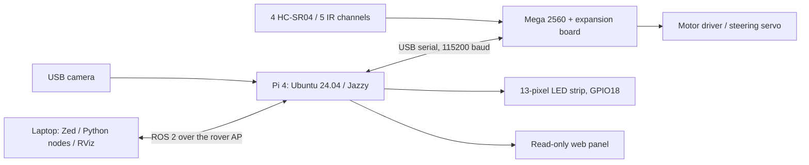

# EyeCar ROS 2


Convert an educational EyeCar into a ROS 2 Jazzy rover. This repository contains
the Mega firmware, Raspberry Pi nodes, a read-only camera panel, a laptop
development container, and the wiring and model references for the build.

| Physical rover | Visual model |
| --- | --- |
|  |  |

[All photographs and model views](docs/Gallery.md) · [Wiring](docs/Wiring.md) ·
[Build guide](docs/README.md) · [Model downloads](models/eyecar/README.md)

## What runs where



The Pi runs the hardware-facing services. Student nodes can run on the laptop
and exchange messages with the Pi over its Wi-Fi AP. The Mega runs an Arduino
sketch, not ROS. The browser panel displays data and does not control motion.

## Build the rover

Follow the [build guide](docs/README.md) in order:

1. [Identify the hardware and connect signals](docs/Wiring.md).
2. [Provision Ubuntu and install ROS 2 Jazzy](docs/ROS2_FIRST_START.md).
3. [Build and upload the Mega firmware](docs/ROS_WORKFLOW_AND_FIRMWARE.md).
4. [Install the Pi services and camera panel](docs/WEB_PANEL.md).
5. [Enable the AP and direct ROS connection](docs/NETWORKING.md).
6. [Open the laptop development container](docs/DEVELOPMENT.md).

The supplied service files use the account `mavxa` and workspace
`/home/mavxa/ros2_ws`. Change those paths if your Pi account differs.
Pin assignments describe this build; check your expansion-board revision.

## Work from the laptop

On a Linux laptop with Docker, clone the repository if needed:

```bash
git clone https://github.com/mavxa/eyecar-ros2.git
cd eyecar-ros2
```

From the repository root:

```bash
docker build -t eyecar-ros2:jazzy .
docker compose up -d
docker exec -it eyecar-ros2 bash
```

Inside the container:

```bash
cd /workspace/ros2_ws
colcon build --symlink-install --packages-select eyecar_teleop
source install/setup.bash
ros2 run eyecar_teleop keyboard_teleop
```

Connect the laptop to the rover AP before starting networked nodes. The Pi
needs the one-time DDS activation in [NETWORKING.md](docs/NETWORKING.md).
Zed can open the same environment through `.devcontainer/devcontainer.json`.
There is no automatic launch of RViz or control nodes.

For the model, sonar arrows and command-based animation, use the
[three-terminal RViz workflow](docs/NETWORKING.md#rviz-with-the-rover-model).
An offline preview with synthetic data is also available:

```bash
bash scripts/eyecar-rviz build
bash scripts/eyecar-rviz demo
```

## Interfaces

| Interface | Purpose |
| --- | --- |
| `/cmd_vel` | Throttle and steering commands using `geometry_msgs/msg/Twist` |
| `/eyecar/ultrasonic` | Four distances in centimeters, rear/right/left/front |
| `/eyecar/infrared` | Five raw ADC channels, A0-A4 |
| `/eyecar/led/color` | Fill the strip with one RGB color |
| `/eyecar/led/set_leds` | Set individual pixels through a ROS service |
| `/camera/image_raw`, `/camera/image_raw/compressed` | Camera images for ROS nodes |
| `http://192.168.50.1/` | Camera and topic browser on the rover AP |

The current `/cmd_vel` adapter normalizes `linear.x` to throttle and
`angular.z` to steering. It is not calibrated velocity/yaw-rate control.
The RViz path is an estimate from commands, not measured odometry.
See [sensor contracts](docs/SENSORS.md), [LED examples](ros2_ws/src/eyecar_led/README.md)
and [vision experiments](docs/VISION.md).

## Repository map

| Directory / file | Contents |
| --- | --- |
| `ros2_ws/src/` | ROS packages for the base, keyboard, LEDs, camera and panel bridge |
| `firmware/` | Mega 2560 sketch |
| `deploy/` | Pi services, Nginx, MediaMTX and DDS profiles |
| `Dockerfile`, `compose.yaml`, `.devcontainer/` | Laptop ROS environment |
| `web/` | Vite / JavaScript panel source |
| `scripts/`, `examples/` | Model tools, viewer and example nodes |
| `public/` | Six photographs of the physical rover |
| `models/eyecar/` | Dimensions, URDF, STL, OpenSCAD and drawings |
| `docs/` | English setup and development guides |

The stock SD image, private backups and trained YOLO weights are not included.
The model is approximate visual geometry. This repository does not yet contain
a Webots physics simulation.

Licensed under the [MIT License](LICENSE).
