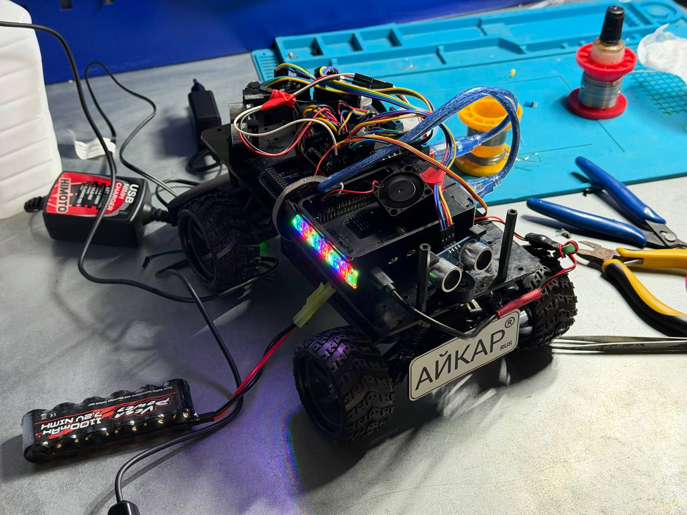
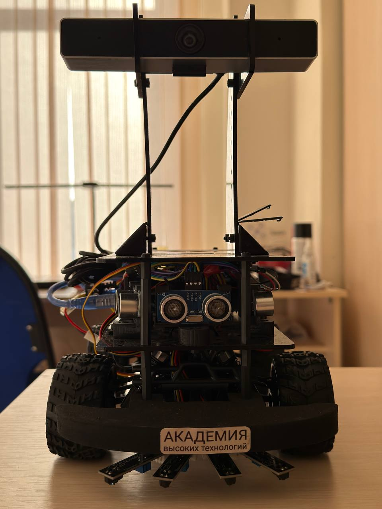
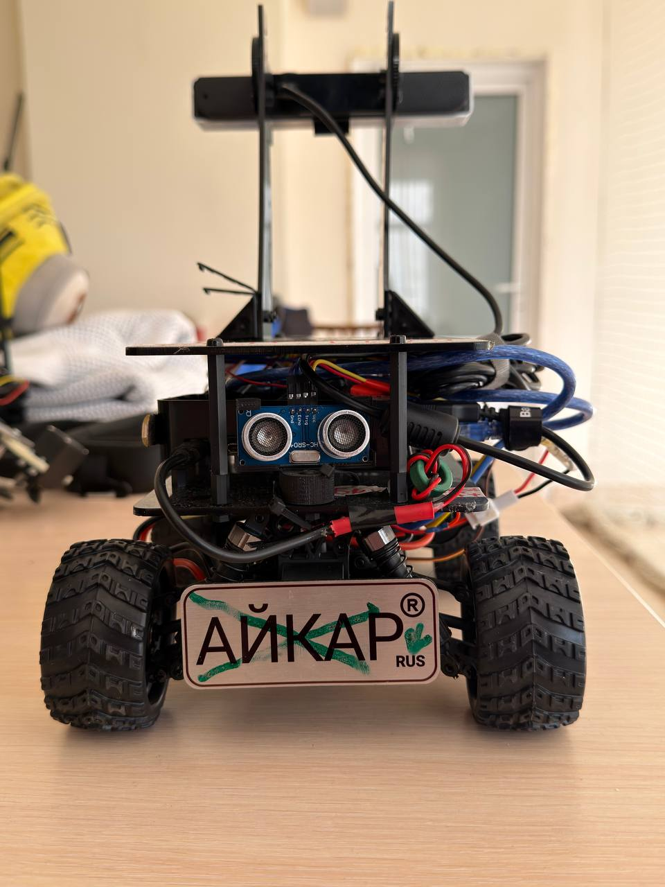
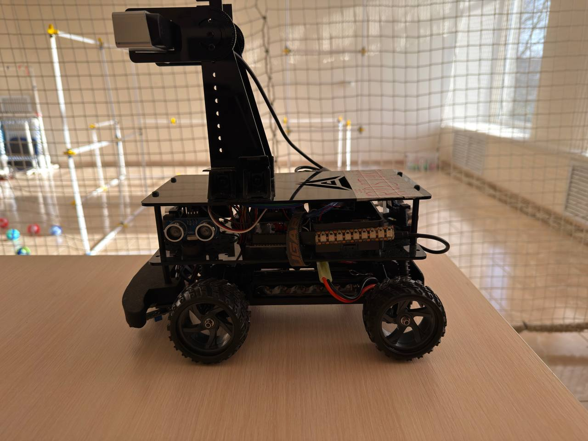
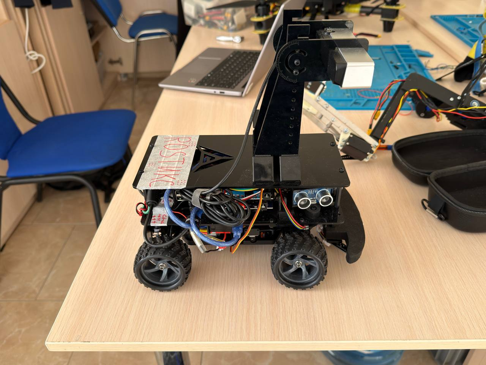
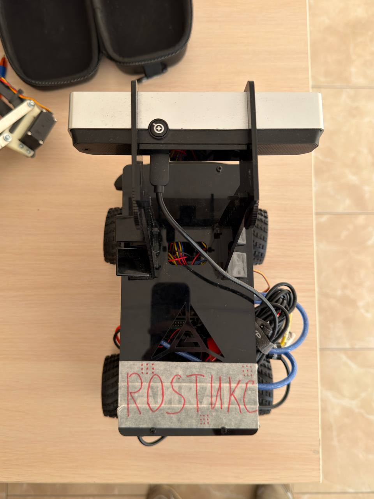

# Rover and model gallery

These photographs show the physical EyeCar used by this project. Keep them
beside the [wiring reference](Wiring.md) when identifying components. The
generated model is an approximate visual reference, not a survey of hidden
wires or a manufacturing drawing.

## On the workbench

The rover during assembly, with the upper electronics exposed and the LED
strip running. This view also appears at the start of the project README.

## Physical rover

### Front

The front bumper, central HC-SR04, sideways-facing modules, camera mast and
IR boards beneath the bumper are visible. The camera is supported at its
mounting bracket height.

### Rear

The rear HC-SR04 and chassis power cabling are visible below the upper plate.

### Left side

The side view shows the stacked plates, side-facing ultrasonic module,
addressable LED strip and camera support.

### Right side

The USB and sensor cables run between the plates. Follow pin labels and
continuity when tracing them; this photograph is not a connector map.

### Top

The top plate covers much of the electronics. The long USB camera is mounted
across the front of the mast.

## Generated model

### Three-dimensional preview

The model includes the chassis stack, wheels, steering joints, electronics,
sensor modules, bumper and camera mast. See [dimensions and assumptions](../models/eyecar/README.md)
before treating any unmeasured feature as exact.

### Orthographic drawing

These are reference views with dimensions, not sheet-metal flat patterns.
[Open the SVG](../models/eyecar/generated/eyecar%20drawing.svg) or
[download the DXF](../models/eyecar/generated/eyecar%20drawing.dxf) for closer inspection.

### RViz scene

This screenshot uses synthetic demo data. It shows the visual model, sensor
arrows and command-derived path. It is not evidence of measured odometry or
a successful run on the physical rover.

## Model files

| File | Purpose and units |
| --- | --- |
| [URDF](../models/eyecar/generated/eyecar.urdf) | Visual robot description, meters |
| [ROS parameters](../models/eyecar/generated/robot_state_publisher.yaml) | Generated `robot_description` for `robot_state_publisher` |
| [OpenSCAD](../models/eyecar/generated/eyecar.scad) | Editable assembly, millimeters |
| [STL](../models/eyecar/generated/eyecar.stl) | Assembly mesh, millimeters; overlapping components |
| [DXF](../models/eyecar/generated/eyecar%20drawing.dxf) | Orthographic CAD reference, millimeters |
| [SVG drawing](../models/eyecar/generated/eyecar%20drawing.svg) | Scalable drawing |
| [PNG drawing](../models/eyecar/generated/eyecar%20drawing.png) | Raster drawing preview |
| [3D preview](../models/eyecar/generated/eyecar%20preview.png) | Rendered visual assembly |
| [RViz screenshot](../models/eyecar/generated/eyecar%20rviz.png) | Offline demo scene |

Edit [dimensions.json](../models/eyecar/dimensions.json) and run
`python3 scripts/eyecar_model.py` from the repository root to regenerate the
model exports. Full image generation needs Matplotlib; the runtime URDF path
uses only the Python standard library. [RVIZ.md](RVIZ.md) explains the viewer.
