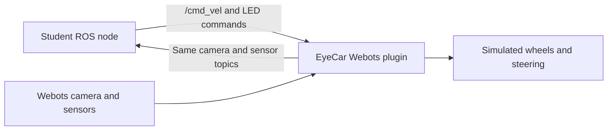

# EyeCar in Webots

The simulator uses the official `webots_ros2_driver` with ROS 2 Jazzy and
Webots R2025a. EyeCar's visual parts and dimensions come from the same generator
as the RViz model. The simulated robot has four driven wheels, front Ackermann
steering, a camera, four sonar devices, five approximate IR inputs and 13 RGB LEDs.

Student nodes use the same topic names and message types as on the Pi. Webots
replaces the physical base, camera and LED drivers. Arduino firmware is not run
or emulated. No connection to the Pi is needed.

## Which container to use

For a simulation lesson, use **only `eyecar-sim`**. It contains Webots, ROS,
RViz and Python, so your node and RViz can run in additional terminals of the
same container. The normal `eyecar-ros2` container is for work with the real Pi;
it is not required as a second viewer container.

The older `bash scripts/eyecar-rviz` launcher creates an SSH telemetry viewer
for the real rover in domain 81. Use the RViz command below inside `eyecar-sim`
for simulation; that older SSH viewer is a separate workflow.

The simulator uses domain **42** and `LOCALHOST` discovery. This keeps its
`/cmd_vel` and camera topics separate from the physical rover on domain **0**.
No AP connection or DDS XML file is needed for simulation. Docker uses the host
network, so processes on the laptop can join the simulation by using the same
ROS environment. A domain number selects a ROS graph; it does not create Wi-Fi.


The screenshot was captured with software rendering in a virtual X11 desktop.
It verifies the model's appearance; native desktop/GPU performance is a separate check.



## Build on the Linux laptop

Run on the host from the repository root. The first image is the existing
development environment; skip its build if it is already current. The second
adds Webots and its ROS driver without changing the regular development image.
The simulator image currently targets **x86-64 Linux**, not the ARM64 Pi.

```bash
docker build -t eyecar-ros2:jazzy .
docker build -f deploy/webots/Dockerfile -t eyecar-webots:jazzy .
docker compose -f compose.sim.yaml up -d
docker exec -it eyecar-sim bash
```

Create the simulation overlay inside the container:

```bash
source /opt/ros/jazzy/setup.bash
source /workspace/deploy/ros-sim.bash
colcon --log-base /tmp/eyecar-sim/log build \
  --base-paths /workspace/ros2_ws/src \
  --build-base /tmp/eyecar-sim/build \
  --install-base /tmp/eyecar-sim/install \
  --symlink-install --packages-select eyecar_interfaces eyecar_sim eyecar_teleop
source /tmp/eyecar-sim/install/setup.bash
ros2 launch eyecar_sim sim.launch.py
```

The overlay lives in the container's `/tmp`, so it needs rebuilding after
container recreation. It survives stopping/restarting the same container.
This avoids overwriting the regular development workspace's build products.
Python edits use the source mount; restart the simulator to load plugin changes.

Start Compose from your graphical desktop terminal so it receives `DISPLAY`
and `XAUTHORITY`. The supplied X11 setup uses XWayland on a Wayland desktop.
Software rendering is selected for portability. Its speed depends on the CPU;
hardware GPU rendering has not been configured or verified by this setup.

For a session without a display, replace the final launch command with:

```bash
WEBOTS_OFFSCREEN=1 ros2 launch eyecar_sim sim.launch.py gui:=false
```

This uses Xvfb. The main 3D view is hidden, while camera rendering and ROS
messages remain available. Close Webots or press Ctrl+C in the launch terminal
to end the session. Starting two worlds on the default Webots controller port
is not supported by this example.

## Run your node or teleop

Open another host terminal:

```bash
docker exec -it eyecar-sim bash
source /workspace/deploy/ros-sim.bash
source /tmp/eyecar-sim/install/setup.bash
ros2 topic list
ros2 topic echo /eyecar/ultrasonic
```

Then run your own script, or the existing teleop:

```bash
ros2 run eyecar_teleop keyboard_teleop
# Or, for your own node:
python3 /workspace/scripts/my_node.py --ros-args -p use_sim_time:=true
```

The last path is an example; create your script first. Use ROS timers and the
node clock for behaviour timing, with `use_sim_time:=true`, so pausing or slowing
Webots also pauses or slows the algorithm. `time.sleep` and Python wall clocks
do not follow simulation time. The driver stops stale commands after 0.5 seconds
of simulated time, matching the hardware adapter's nominal timeout.

## Topic contracts

| Topic / service | Type | Behaviour |
| --- | --- | --- |
| `/cmd_vel` | `geometry_msgs/msg/Twist` | Same throttle/steering convention as EyeCar |
| `/camera/image_raw` | `sensor_msgs/msg/Image` | BGR8, 320×240, at most 10 Hz |
| `/camera/image_raw/compressed` | `sensor_msgs/msg/CompressedImage` | JPEG, same header as raw |
| `/eyecar/ultrasonic` | `std_msgs/msg/UInt16MultiArray` | Rear/right/left/front, cm; 0 means no echo |
| `/eyecar/infrared` | `std_msgs/msg/UInt16MultiArray` | Five approximate ADC channels, 0–1023 |
| `/eyecar/led/color` | `std_msgs/msg/ColorRGBA` | Fill all 13 pixels |
| `/eyecar/led/brightness` | `std_msgs/msg/UInt8` | Brightness 0–255 |
| `/eyecar/led/state` | `eyecar_interfaces/msg/LedStateArray` | Latched per-pixel RGB values |
| `/eyecar/led/brightness_state` | `std_msgs/msg/UInt8` | Latched brightness |
| `/eyecar/led/set_leds` | `eyecar_interfaces/srv/SetLeds` | Set pixels 0–12 |
| `/joint_states`, `/tf`, `/tf_static` | Standard ROS types | Model and measured simulated wheel positions |
| `/clock` | `rosgraph_msgs/msg/Clock` | Simulation time |
| `/simulation/odom` | `nav_msgs/msg/Odometry` | Simulated GPS position/yaw and derived planar velocity |

Distance arrays are published at about 5 Hz. Sonar angles and maximum range
are modelled, but echoes, crosstalk and electronics noise are not calibrated.
IR placement and response are provisional: the visual model has four boards,
while the firmware exposes five channels. Do not tune real line-following
thresholds against this approximation.

Example JPEG from the simulated camera, with the blue target beside the wall:


`/cmd_vel` is **not standard calibrated velocity control** on this rover.
The simulator clamps `linear.x` to ±0.25, then applies the configurable
`simulation_speed_scale` of 1.25. This gives a nominal limit of ±0.3125 m/s,
25% faster than the first version. It maps
`angular.z` / 0.85 to ±30° central steering, then computes Ackermann wheel
angles and speeds. These constants make the existing teleop usable; they do
not identify the real ESC response. Brake/reverse arming pulses are not emulated.
The simulated camera's horizontal FOV is 90°, configured by
`camera_horizontal_fov_deg` in the shared dimensions file. This is a simulation
setting, not a measurement of the physical camera lens.

The scene provides a floor, a wall, a blue cylinder and a red obstacle. A real
YOLO model may fail to recognise such simple rendered objects. Use the scene
to test message flow and reactions, then test detection with the real camera.
Training data, competition objects and photorealistic rendering are not included.

## RViz

From a prepared simulation container shell:

```bash
source /workspace/deploy/ros-sim.bash
source /tmp/eyecar-sim/install/setup.bash
rviz2 -d /workspace/ros2_ws/src/eyecar_sim/config/sim.rviz \
  --ros-args -p use_sim_time:=true
```

The fixed frame is `sim_odom`. The pose comes from Webots physics, unlike the
real rover's command-derived RViz estimate. Do not run `rviz_bridge.py` in this
domain: it would add a second source of wheel joints and body transforms.

## Switch to the real rover

Simulation Compose uses loopback DDS and **domain 42**; the rover setup uses
**domain 0**. The simulation launch refuses domain 0. Keep simulation commands
out of the physical rover's domain.

1. Stop the student node and Webots.
2. Connect to the rover AP and use the regular development container, or SSH.
3. Source the real environment described in [NETWORKING.md](NETWORKING.md).
4. Run the same student node against the real camera/LED topics. Remove
   `use_sim_time:=true`, or set it to false: the Pi does not publish `/clock`.
5. Test LED reactions first; verify any movement separately on the real hardware.

The node should subscribe to the camera topic rather than hard-code a USB
device. Model-file paths and behaviour thresholds can be parameters. YOLO must
be installed in the environment running the student node; the simulator image
provides ROS/OpenCV, not a trained model or an Ultralytics environment.

## Troubleshoot domain errors (issue #2)

`RuntimeError: Use a separate simulation domain` means that the launch process
received domain 0 or no domain setting. `InvalidFrontendLaunchFileError` is the
launch loader's follow-up error, not evidence of broken Python syntax or DHCP.
Older simulator images inherited domain 0 from the development image; only
Compose set domain 42. The simulator image now sets 42 itself.

For an already built container, fix the current shell without rebuilding:

```bash
source /workspace/deploy/ros-sim.bash
source /tmp/eyecar-sim/install/setup.bash
printenv ROS_DOMAIN_ID ROS_AUTOMATIC_DISCOVERY_RANGE
ros2 launch eyecar_sim sim.launch.py
```

Expect `42` and `LOCALHOST`. Source `ros-sim.bash` in every RViz/student-node
terminal as well; it clears a previously selected rover DDS XML and static peers.
Stop and restart nodes after switching. An exported variable changes child
processes, not nodes that are already running. Do not source Pi/AP environment
files in a simulation shell.

To keep the fixed defaults for future containers, rebuild the simulator image
and recreate its Compose container with
`docker compose -f compose.sim.yaml up -d --force-recreate`.
Rebuild the temporary overlay afterwards. A Zed window
opened through the root `.devcontainer` still selects the real-rover container;
check the container name before running the simulation instructions.

## Change the robot or scene

Edit `models/eyecar/dimensions.json` for shared geometry, then run on the host:

```bash
python3 scripts/eyecar_webots.py
python3 scripts/eyecar_webots.py --check
```

The generator reuses `parts_for()` and `make_urdf()` from the existing model
tool. It writes `eyecar_sim/protos/EyeCar.proto` and the installed model/config.
Generated files should not be edited manually. The chassis mass is provisionally
1 kg, each wheel 50 g and each steering knuckle 10 g; tyre friction, torque,
collision shapes and mass distribution need measurements before quantitative use.

Edit `ros2_ws/src/eyecar_sim/worlds/practice.wbt` for objects and lighting.
Restart Webots after a geometry/world change. No hardware firmware change is needed.

## Verify

Host-side geometry/control tests:

```bash
python3 -m unittest discover -s tests -p 'test_*.py'
python3 scripts/eyecar_webots.py --check
```

With a **freshly started** simulation, run inside its prepared container shell:

```bash
python3 /workspace/tests/webots_integration.py
```

The integration check verifies camera JPEGs, sensor arrays, physical forward and
reverse displacement, wall collision, Ackermann steering, command timeout, LED fill and a
per-pixel service call. It publishes test commands only after finding the
simulator's `/simulation/odom` publisher in domain 42. It stops the command at
the end. Restart the scene before repeating the test.

To remove only the simulation container:

```bash
docker compose -f compose.sim.yaml down
```

References: [official webots_ros2](https://github.com/cyberbotics/webots_ros2),
[Jazzy Webots tutorial](https://docs.ros.org/en/jazzy/Tutorials/Advanced/Simulators/Webots/Setting-Up-Simulation-Webots-Basic.html),
[Webots R2025a release](https://github.com/cyberbotics/webots/releases/tag/R2025a).
