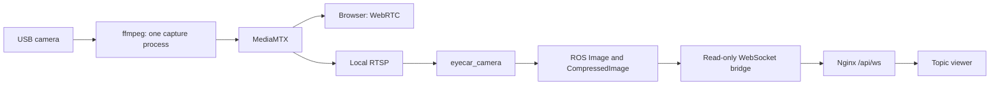

# Camera and topic panel

Open `http://eyecar.local/` or the Pi's IP address. The home page lists cameras
and ROS topics. A topic page shows its type and latest messages.
`/cameras/cam/` shows the USB camera; `/cam/` is the camera-only view for F11
or a second monitor. The browser sends no driving commands.

## Data paths



The bridge binds `127.0.0.1:9090`. It accepts only `list_topics`, `watch` and
`unwatch`, rejecting publishing and other operations. Each connection watches
one topic. Updates are limited to 10 Hz per topic; the browser retains the last
30 messages. Raw images appear as metadata, while compressed JPEGs can be viewed.

`eyecar_camera` reads local RTSP rather than opening the USB device again. It
publishes `/camera/image_raw` and `/camera/image_raw/compressed`, initially at
10 Hz with JPEG quality 70. Browser video uses WebRTC independently of ROS images.

## Edit on the laptop

```bash
cd web
bun install
bun run dev
```

Open `http://127.0.0.1:5173/`. Without a Pi, the development page shows a labelled
demo dataset. `/?live=1` selects the live API. Vite updates the page as you edit
`index.html`, `styles.css` and `app.js`. Build with `bun run build`; the Pi serves
only `web/dist/` and does not need Bun or Vite.

## Install on the Pi

Complete the [ROS installation and workspace build](ROS2_FIRST_START.md) first.
The supplied units use `/home/mavxa`; adapt their paths for a different account.
Back up existing deployment files before replacing them. Keep the current DDS
profile on an existing rover; the loopback defaults below are for a fresh install.

```bash
sudo apt install nginx avahi-daemon ffmpeg python3-opencv ros-jazzy-rmw-cyclonedds-cpp
sudo hostnamectl set-hostname eyecar
sudo systemctl enable --now avahi-daemon
sudo usermod -aG dialout,video "$USER"
mkdir -p ~/.local/bin ~/eyecar_web ~/.config/systemd/user
```

Reconnect SSH after changing groups. Download the **Linux ARM64** archive from
[MediaMTX releases](https://github.com/bluenviron/mediamtx/releases). Extract it
in a temporary directory and install its `mediamtx` executable as
`~/.local/bin/mediamtx`. Record the selected version with
`~/.local/bin/mediamtx --version`. The project uses a USB UVC camera, not the
MediaMTX `rpiCamera` source. See [upstream installation](https://github.com/bluenviron/mediamtx/blob/main/docs/1-kickoff/2-install.md).

From `~/eyecar-ros2` on the Pi, for the first installation:

```bash
cp deploy/ros-local.env deploy/cyclonedds-loopback.xml deploy/mediamtx.yml ~/eyecar_web/
cp deploy/systemd-user/*.service ~/.config/systemd/user/
sudo cp deploy/systemd/eyecar-led.service /etc/systemd/system/
```

Add the active DDS environment to `~/.bashrc` once:

```bash
set -a; source ~/eyecar_web/ros-local.env; set +a
```

The camera configuration requests MJPEG at 640×360 and 30 fps from `/dev/video0`.
Check that the camera supports that mode with `v4l2-ctl --list-formats-ext`
(from `v4l-utils`), and adjust `deploy/mediamtx.yml` before copying if necessary.
The LED service needs the hardware dependencies in the [LED package guide](../ros2_ws/src/eyecar_led/README.md).

Install the Nginx site, keeping any existing site configuration backed up:

```bash
sudo cp deploy/nginx/eyecar.conf /etc/nginx/sites-available/eyecar
sudo ln -sfn /etc/nginx/sites-available/eyecar /etc/nginx/sites-enabled/eyecar
if [ -L /etc/nginx/sites-enabled/default ]; then sudo unlink /etc/nginx/sites-enabled/default; fi
sudo install -d /var/www/eyecar
sudo nginx -t
```

Build the frontend on the laptop and transfer it:

```bash
cd web
bun install
bun run build
ssh eyecar 'mkdir -p /tmp/eyecar-panel'
scp -r dist/. eyecar:/tmp/eyecar-panel/
ssh eyecar 'sudo cp -a /tmp/eyecar-panel/. /var/www/eyecar/'
```

On the Pi, enable the installed services:

```bash
systemctl --user daemon-reload
sudo systemctl daemon-reload
sudo loginctl enable-linger "$USER"
systemctl --user enable --now eyecar-base eyecar-rosbridge eyecar-video eyecar-camera
sudo systemctl enable --now eyecar-led nginx
```

For a later frontend-only update, copy the new `dist/` contents again. No ROS
rebuild is needed. Remove obsolete frontend assets from the deployment only
after checking that they are no longer referenced. If migrating the old panel,
disable its `eyecar-web.service` on port 8080; it is not used by this version.

## Verify access

Open `/`, `/cmd_vel/`, `/cameras/cam/` and `/cam/` on a phone and laptop. Test a
direct visit to a nested URL. Confirm the same services return after a reboot.

```bash
systemctl --user status eyecar-base eyecar-rosbridge eyecar-video eyecar-camera
journalctl --user -u eyecar-camera -n 30 --no-pager
journalctl --user -u eyecar-rosbridge -n 30 --no-pager
sudo nginx -t
ros2 topic hz /camera/image_raw
```

Nginx listens on TCP 80; WebRTC uses TCP 8889 and UDP 8189. RTSP stays on
`127.0.0.1:8554`. mDNS requires Avahi and a compatible client; use the IP if
`eyecar.local` does not resolve. An active service alone does not prove video
works: USB permissions, supported formats and actual frame delivery all matter.

The panel and camera have no login. People on the reachable network can view
them. Direct DDS access is a separate permission boundary: when the AP profile
is enabled, AP clients can publish ROS commands even though the panel is read-only.
See [networking](NETWORKING.md) before enabling it.
