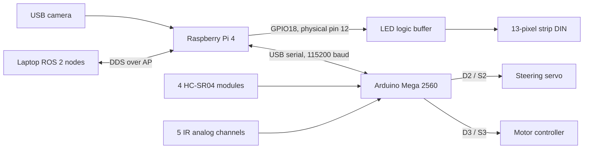

# Wiring reference

This build uses a Raspberry Pi 4 Model B, an Arduino Mega 2560 and the existing
EyeCar expansion board. The Mega handles motor pulses, steering and sensors.
The Pi runs ROS 2, captures the USB camera and drives the addressable LED strip.

The signal assignments below come from the checked-in firmware and LED node.
They describe the intended wiring for this software. Photographs do not prove
which socket a hidden wire reaches. Check connector labels and continuity on
your own rover before applying power.

## Software and control paths



Mermaid shows the system structure on GitHub. The drawings below include the
pin numbers and power notes needed at the workbench; they are also downloadable
as PNG and SVG for use outside a Markdown viewer.

## Connection overview


[Open the vector drawing](images/Connection%20overview.svg).
The logic buffer is recommended for a 5V LED strip; its presence on the
photographed rover has not been verified. The drawing does not specify the
battery, ESC power input or expansion-board VIN routing. Those depend on the
actual power hardware and its ratings.

## Arduino Mega signals


[Open the vector drawing](images/Mega%20signal%20map.svg).
This is a functional map, not the physical layout of the Mega headers.

| Connection | Mega pin | Expansion-board label / use |
| --- | --- | --- |
| Motor driver signal | D3 | S3 signal row |
| Steering servo signal | D2 | S2 signal row |
| US1 TRIG / ECHO | D5 / D6 | Rear sensor in the project mapping |
| US2 TRIG / ECHO | D7 / D8 | Right sensor |
| US3 TRIG / ECHO | D10 / D11 | Left sensor |
| US4 TRIG / ECHO | D12 / D13 | Front sensor |
| IR channel 0 | A0 | Module AO output |
| IR channel 1 | A1 | Module AO output |
| IR channel 2 | A2 | Module AO output |
| IR channel 3 | A3 | Module AO output |
| IR channel 4 | A4 | Module AO output |
| ROS serial connection | USB-B | Cable from a Pi USB-A port |

S2 and S3 are shield signal sockets corresponding to Mega D2 and D3. They are
not Raspberry Pi pins. The firmware uses `Servo.writeMicroseconds()` for both
control outputs. A generic H-bridge with separate direction and duty-cycle
inputs needs a different driver and wiring.

Every HC-SR04 needs VCC and GND in addition to TRIG and ECHO. Its 5V ECHO goes
to the Mega, not to a Pi GPIO. IR modules currently use their analog AO output;
the firmware reads 0-1023 from A0-A4. Match IR supply voltage to the actual
module. Firmware channel order does not establish the modules' physical order.

Source: [controller sketch](../firmware/eyecar_base_controller/eyecar_base_controller.ino).
The ultrasonic positions follow the project's rear/right/left/front mapping.
Verify it by moving an object in front of one sensor at a time while watching
`/eyecar/ultrasonic`.

## Raspberry Pi 4 header


[Open the vector drawing](images/Pi%20GPIO%20header.svg).
Locate physical pin 1 from the board marking. The drawing is a top view of
the header, independent of how the board is rotated in the chassis.

| Project connection | Pi connection | Notes |
| --- | --- | --- |
| Arduino data | USB-A to Mega USB-B | No GPIO UART connection |
| Camera | USB-A | UVC video device |
| Pi power | USB-C | Regulated 5V supply sized for a Pi 4, normally 3A |
| LED data | BCM GPIO18, physical pin 12 | Through a suitable 3.3V-to-5V logic buffer to DIN |
| LED signal ground | Physical pin 6, GND | Shared with the LED supply; other GND pins also work |
| LED power | Rated 5V distribution / supply | Not from a GPIO signal pin |

The strip has **13 pixels**. That is a count, not GPIO13. The driver defaults
to **BCM GPIO18**, which is **physical pin 12**. Data must reach the strip's
DIN end; the arrows on the strip point away from that input.

A 74AHCT125 is one suitable buffer for a 5V strip. Power it from 5V, connect
its GND and the used channel's active-low OE to common ground, route GPIO18 to
input A, and output Y to DIN. Check the pin labels for your specific IC or
breakout. Pi GPIO is 3.3V logic and is not 5V tolerant.

Source: [LED node](../ros2_ws/src/eyecar_led/eyecar_led/led_strip.py).
The system service selects 13 pixels and brightness 32; the node's standalone
brightness default is 64. These are software settings, not a measurement of
the strip's maximum current.

## Power before software

The project currently powers the Pi through USB-C from a regulated supply.
The motor driver and servo retain their rated power path. Keep signal grounds
common. USB may also power the Mega's logic; inspect the actual shield and
power-selection circuit before combining USB, VIN and another 5V source.
Do not infer voltage or polarity from wire color alone.

Check the output of a BEC before connecting it. Raw battery voltage does not
belong on Pi USB-C, Pi 5V pins or LED DIN. If the motor supply is disconnected,
the Pi and serial connection may still work while the wheels cannot move.

## Regenerate the references

From the repository root on the laptop:

```bash
python3 scripts/eyecar_wiring.py
python3 scripts/eyecar_wiring.py --check
```

The generator reads the firmware and LED defaults and writes the SVG files.
To refresh the PNG previews with `rsvg-convert` installed:

```bash
for drawing in docs/images/*.svg; do
  rsvg-convert "$drawing" -o "${drawing%.svg}.png"
done
```

References: [Arduino Mega pinout](https://docs.arduino.cc/resources/pinouts/A000067-full-pinout.pdf),
[Raspberry Pi GPIO](https://www.raspberrypi.com/documentation/computers/raspberry-pi.html#gpio),
[Pi power requirements](https://www.raspberrypi.com/documentation/computers/getting-started.html#power-supply),
[NeoPixel connections and level shifting](https://learn.adafruit.com/adafruit-neopixel-uberguide/basic-connections).
